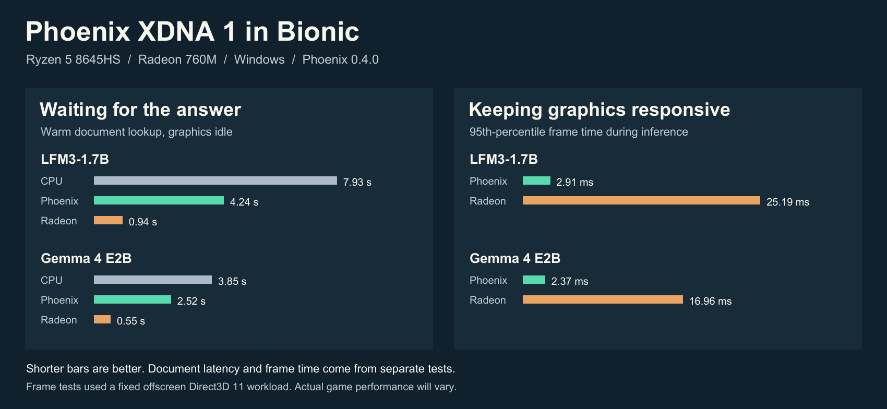

# Phoenix XDNA 1 Runtime

Run local GGUF language models on a first-generation AMD Ryzen AI NPU in Bionic on Windows. Phoenix 0.5.0 adds native one-bit Bonsai 27B output scoring and optional integrated Radeon placements. The default engine splits supported operations between XDNA 1 and the CPU. Bionic loads the same GGUF from your library.

**Phoenix is most useful for reading long prompts while the Radeon is needed for graphics.** On a Ryzen 5 8645HS, Phoenix 0.4.0 shortened the warm wait for the first visible answer by **47% on LFM3-1.7B** and **35% on Gemma 4 E2B** versus Bionic’s stock CPU engine. [Download the latest stable Windows runtime](https://github.com/MirakSalama/phoenix-xdna1-runtime/releases/latest)

## Install and run

1. Use Windows x64, PowerShell 7 and an AMD Phoenix or Hawk Point processor with an **XDNA 1 NPU** and a working Windows XRT driver. The hardware measurements below come from one Ryzen 5 8645HS laptop.
2. Install **Vulkan llama.cpp (Windows) 2.80.1** in Bionic and **Phoenix XDNA 1 0.4.0**. If setting up 0.4.0 from scratch, install **CPU llama.cpp (Windows) 2.80.1** first. Radeon placements also require the AMD Vulkan driver and one integrated AMD graphics adapter. The 0.5.0 installer checks the exact local inputs against its checksum lock. [0.4.0 prerequisite](https://github.com/MirakSalama/phoenix-xdna1-runtime/releases/tag/v0.4.0) · [0.5.0 dependency lock](runtime/runtime-lock.json)
3. Download the **0.5.0 runtime ZIP** under **Assets** and extract it. Open PowerShell 7 in the extracted directory. The first command verifies the local inputs and packaged native code. The installer stages a separate version and leaves previous versions available. [Latest release assets](https://github.com/MirakSalama/phoenix-xdna1-runtime/releases/latest)

```powershell
.\install.ps1 -CheckOnly
.\install.ps1
lms runtime select phoenix-xdna1-win-x86_64-avx2@0.5.0
```

4. Load or reload your GGUF in Bionic and start a chat. You can also choose **Settings → Runtime → GGUF → Phoenix XDNA 1 (Windows) 0.5.0**. To switch back, select the previous engine and reload the model.

## Bonsai 27B on XDNA 1

For compatible Q1_0 rows with a hidden width of 5,120, the new 16-core NPU program reads the original packed one-bit signs and FP16 scales, accepts BF16 activations and returns FP32 scores. Phoenix normally sends 3,072 of Bonsai's 248,320 output scores to XDNA and scores the remaining rows on the CPU. A standalone 40-call trial measured a median of **0.764 ms for the slice**. Its weight storage was **2.11 MiB** versus **30 MiB** for the expanded BF16 path. Existing GGUF and Bionic chat timings include the rest of the model. [Placement and kernel details](runtime/README.md)

## What gets faster

The document test asked for a pickup code buried in nine records, roughly 1,000 input tokens. Each engine used the same local weights and answered one request at a time. The table shows the median time to **first visible answer text** across four different documents after the first request on a loaded model. The default Phoenix configuration uses compact weights and shares eligible vocabulary work with the CPU.

| Model and GGUF | Stock CPU | Phoenix 0.4.0 | Radeon 760M Vulkan |
| --- | ---: | ---: | ---: |
| LFM3-1.7B QAD Q4_0 | 7.93 s | **4.24 s** | 0.94 s |
| Gemma 4 E2B IT Q4_0 | 3.85 s | **2.52 s** | 0.55 s |

Radeon Vulkan delivered the quickest answers on this laptop. Generating output tokens also favored the GPU. For example, on a separate LFM3 40-token task, the Radeon generated 63.44 output tokens/s, CPU 43.82, and default Phoenix 0.4.0 reached 41.50. Its measured advantage over CPU was concentrated in processing the input. [0.4.0 measurements and test conditions](https://github.com/MirakSalama/phoenix-xdna1-runtime/blob/v0.4.0/runtime/README.md)

A separate test ran a fixed 1280 × 720 offscreen Direct3D 11 graphics workload on the Radeon during chat. On LFM3, the 95th-percentile frame time was **2.91 ms** with Phoenix inference and **25.19 ms** with Radeon inference. On Gemma it was **2.37 ms** and **16.96 ms**, respectively. Radeon still answered sooner. These measurements describe GPU-completed frames in the synthetic test. Games, displays and workloads can behave differently.



For sample sizes, timing boundaries and the decision to retain 0.4.0 after a startup experiment, see the [benchmark methodology and results](docs/benchmarks.md).

## Model coverage and settings

- **LFM3-1.7B QAD Q4_0 and Gemma 4 E2B IT Q4_0.** Supported feed-forward operations run on the NPU during prompt processing. Phoenix reads the original block scales and handles Bionic’s AVX2-repacked weights.
- **SmolLM2-360M Instruct Q4_K_M.** Suitable feed-forward projections can use the NPU. **LFM2.5-230M Q4_K_M** uses CPU prompt processing and can share eligible generation work with the NPU.
- **Other GGUFs.** Bionic’s pinned llama.cpp build determines which files load. Offload depends on tensor shape, weight type and prompt size. A model that opens successfully can still run entirely on CPU.

In 0.5.0 use `.\set-mode.ps1 -Mode cpu-prompt` for CPU generation and eligible XDNA prompt projections, or `cpu-prompt-resident` to permit bounded BF16 caching. Choose `split-head` for Radeon transformer layers with shared CPU/XDNA output scoring, `prompt-ffn` for eligible XDNA prompt work with Radeon, or `radeon` for the GPU control. Restore the CPU and XDNA default with `.\set-mode.ps1 -Mode cpu-npu`. Reload the model after changing settings. [Placement options](runtime/README.md)

## Verify or troubleshoot

- **Installer reports a base-library mismatch.** Check the Windows Vulkan engine and installed Phoenix 0.4.0 with `lms runtime ls` and rerun `.\install.ps1 -CheckOnly`. The runtime lock lists the exact binaries and program hashes.
- **Check the one-bit device program.** From the extracted 0.5.0 archive, run `python -B programs/source/verify.py`. It checks the hashes of the compiled kernel, instructions and build sources. For live work, enable the dispatch trace described in the pack README and check for a new `storage=packed-q1` receipt during a Bonsai reply. [Tracing instructions](runtime/README.md)
- **To reproduce the earlier 0.4.0 release checks,** run the following in the extracted 0.4.0 directory. The city-answer flag allows the documented variation and records raw differences. The verifier temporarily selects the test engines and restores the previous selection. [0.4.0 verification script](https://github.com/MirakSalama/phoenix-xdna1-runtime/blob/v0.4.0/runtime/verify.ps1)

```powershell
$modelLibrary = Read-Host 'Path to your Bionic models folder'
.\verify.ps1 -ModelRoot $modelLibrary -IncludeLargeModels -VerifyResidentBF16 -AllowEquivalentCityAnswer
```

## Releases and project background

| Version | Milestone |
| --- | --- |
| [0.1.0](https://github.com/MirakSalama/phoenix-xdna1-runtime/releases/tag/v0.1.0) | First Bionic replies with verified XDNA 1 execution on ordinary GGUFs. |
| [0.2.0](https://github.com/MirakSalama/phoenix-xdna1-runtime/releases/tag/v0.2.0) | Cached prepared weights, shared CPU/NPU generation and accelerated selected SmolLM2 prompts. |
| [0.3.1](https://github.com/MirakSalama/phoenix-xdna1-runtime/releases/tag/v0.3.1) | Compact four-bit prompt operations on LFM3 and Gemma 4. |
| [0.4.0](https://github.com/MirakSalama/phoenix-xdna1-runtime/releases/tag/v0.4.0) | Wider prompt tiles, overlapping input preparation and selectable generation placement. |
| [0.5.0](https://github.com/MirakSalama/phoenix-xdna1-runtime/releases/tag/v0.5.0) | Native packed one-bit Bonsai output scoring and optional Radeon hybrid placement. |

This runtime grew out of **Phoenix AI**, a separate application with its own releases. Abhiram Jayasankar’s **Ryzen AI NPU Lab**, including its original LFM2.5 NPU engine, helped start the Phoenix AI project. The runtime builds on llama.cpp’s GGML operations and uses AMD XRT to submit work to the NPU. [Phoenix AI](https://github.com/MirakSalama/Phoenix-AI) · [Ryzen AI NPU Lab](https://github.com/AbhiramJayasankar/ryzenai-npu-lab) · [llama.cpp](https://github.com/ggml-org/llama.cpp) · [AMD XRT](https://github.com/Xilinx/XRT)

[Release history](CHANGELOG.md) · [Publishing a verified release](publish/MIRRORING.md) · [Third-party notices](runtime/THIRD_PARTY_NOTICES.md)
