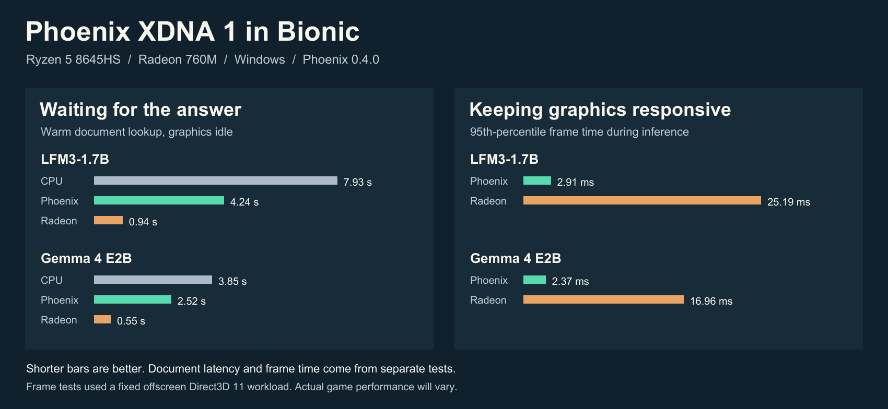

# Benchmarks on the Ryzen 5 8645HS

Phoenix 0.4.0 delivered document answers sooner than Bionic’s CPU engine on the two tested GGUFs. The Radeon 760M answered sooner still. When the Radeon also rendered graphics, Phoenix inference preserved shorter frame times. These measurements come from one Windows laptop with XDNA 1, the integrated Radeon 760M and Bionic’s llama.cpp 2.80.1 runtime.

## Released 0.4.0 pack

The request asks for a pickup code in about 1,000 tokens of records. Each model runs one greedy request at a time in a 1,536-token context. After the first request on the loaded model, four warm requests change the packet and the target code. Each cell reports the median wall time from sending the request to receiving the first visible text. Phoenix used its default compact weights and split vocabulary computation.

| Model | CPU | Phoenix 0.4.0 | Radeon Vulkan |
| --- | ---: | ---: | ---: |
| LFM3-1.7B QAD Q4_0 | 7.929 s | 4.239 s | 0.935 s |
| Gemma 4 E2B IT Q4_0 | 3.851 s | 2.517 s | 0.545 s |

All ten document replies matched the CPU’s text and input/output token counts. The full default suite covered 70 replies across four models. One LFM3 city-name response repeated “Paris” with extra markup. [Release details](../runtime/README.md)

## Graphics running during inference

A fixed 1280 × 720 offscreen Direct3D 11 workload rendered on the Radeon. Each frame waited for GPU completion. The render workload ran before, during and after inference so each engine had a nearby graphics-only baseline. Each model/engine combination received one first document and four different warm documents, both with and without rendering, for 40 replies. All 40 matched their CPU references. Device logs confirmed AMD Vulkan layer offload for the Radeon trials and completed XDNA prompt operations for Phoenix.

| Model | Inference engine | First visible text with graphics, median | Frame time with graphics alone, p95 | Frame time during inference, p95 |
| --- | --- | ---: | ---: | ---: |
| LFM3-1.7B | Phoenix | 5.123 s | 1.54 ms | 2.91 ms |
| LFM3-1.7B | Radeon Vulkan | 0.875 s | 1.30 ms | 25.19 ms |
| Gemma 4 E2B | Phoenix | 3.325 s | 1.34 ms | 2.37 ms |
| Gemma 4 E2B | Radeon Vulkan | 0.580 s | 1.93 ms | 16.96 ms |

The 95th percentile describes the slower end of the frame-time distribution. Phoenix kept frame times shorter during the answer. Radeon inference finished sooner, so graphics contention also ended sooner. The workload measured offscreen GPU-completed frames. It did not measure game FPS, display refresh or energy use.

## Startup experiment 031

The experimental 0.4.94 build used six CPU prompt threads for the tested LFM3 file and four for Gemma. The release threshold was a 10% reduction in **open-to-first text**, measured from opening a fresh worker to the first visible answer. Each adjacent stable/candidate pair used the same document, context, native log handling and tracing. The OS could reuse cached file pages. Each worker received a second, distinct document to measure the warm wait.

| LFM3 outcome | Stable median | Candidate median | Median paired reduction |
| --- | ---: | ---: | ---: |
| Open to first visible text, four pairs | 10.452 s | 9.634 s | **9.60%** |
| Warm request to first visible text, four pairs | 5.602 s | 4.924 s | **11.93%** |

The percentage is computed within each pair before taking the median. A 26.94-second stable opening remained in the primary result. Omitting that pair as a sensitivity check gave **7.04%** over the other three pairs. All four warm requests were faster on the candidate. The complete check comprised four LFM3 pairs and one Gemma control pair, with two replies per worker. All **20 replies** matched CPU text and token counts. The opening result missed the prespecified threshold, so 0.4.94 remained experimental and **0.4.0 remained the stable release**.
